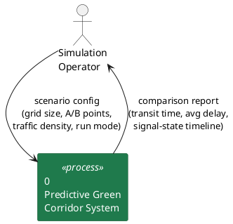
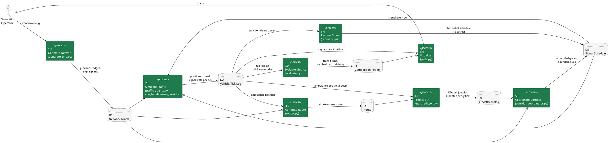
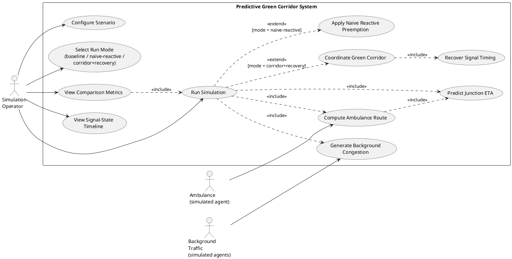
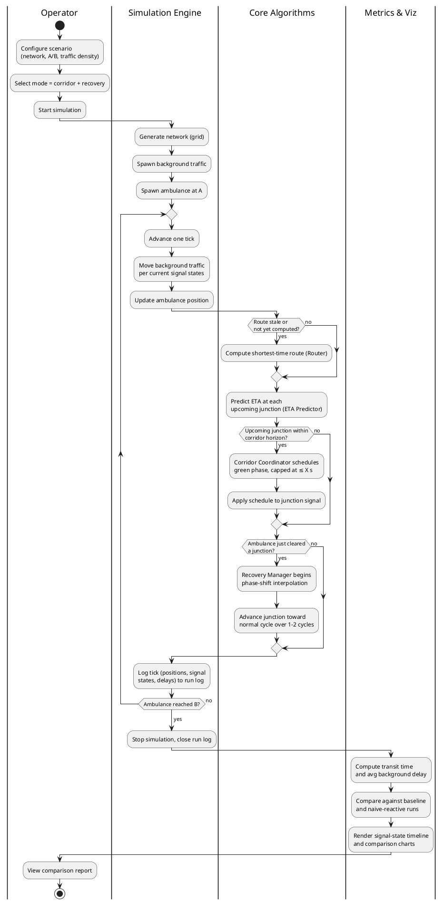
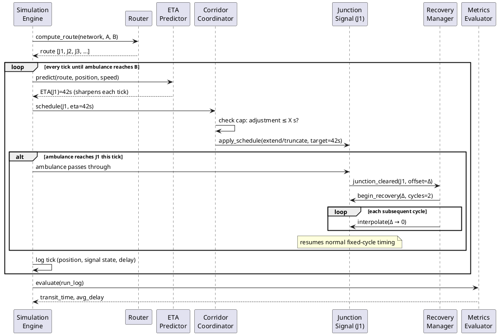
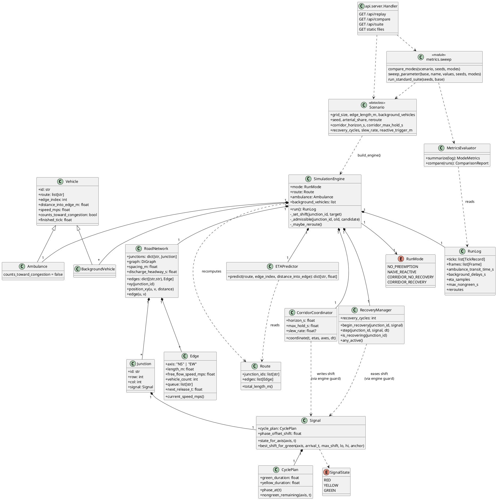

# Appendix B – UML and Data Flow Diagrams (DFD, Use Case, Activity, Sequence, Class)

> The pre-implementation notation set that supports [Chapter 6 – System Design](Chapter6-System-Design.md). The class diagram (D9) has been updated to match the code as built; the others describe the intended design, with changes noted in Chapter 6.

The formal design-notation set for the pre-implementation review: how data
moves through the system, what a user/agent can actually do, how one
simulation run unfolds step by step, how the modules talk to each other with
a clock attached, and the static shape of the classes that will implement
[CLAUDE.md](../../CLAUDE.md) §5–6. Where Appendix A's D1–D4 were informal
architecture sketches, these five are the standard SE documentation set,
drawn in **PlantUML**.

PlantUML doesn't render inline on GitHub the way Appendix A's Mermaid diagrams
do — view these with the PlantUML VS Code/JetBrains extension, `plantuml.com`'s
online server, or a local `plantuml.jar` + Graphviz install.

Companion docs: [CLAUDE.md](../../CLAUDE.md) · [BUILD-PLAN.md](../BUILD-PLAN.md)
· [DECISIONS.md](../DECISIONS.md) · [Appendix-A-Design-Sheets.md](Appendix-A-Design-Sheets.md)

Scope note: all five diagrams model the MVP as scoped in
[CLAUDE.md](../../CLAUDE.md) §3 — synthetic grid network, single ambulance,
three run modes (no-preemption baseline, naive-reactive, predictive
corridor + recovery). OSM import and SUMO are deferred per
[DECISIONS.md](../DECISIONS.md) D1/D2 and are not represented here.

---

## D5 — Data Flow Diagram

### D5a — Context Diagram (Level 0)

The whole system as one process. The only external entity for the MVP is the
person running scenarios — the ambulance and background traffic are
simulated *inside* the system, not real-world data sources, so they don't
appear as external entities here (contrast with the Use Case diagram below,
where they matter as actors).

### D5b — Level 1 Decomposition

Process 0 opened up into the eight processes that correspond 1:1 with the
modules in [CLAUDE.md](../../CLAUDE.md) §5. This is the diagram that should
make the project structure self-evident: every arrow here is a function
call or return value that `core/*.py` and `simulation/*.py` will implement.

**Reading it:**
- **D5 (Signal Schedule) is written by two different processes** — 5.0
  (Coordinate Corridor) and 6.0 (Recover Signal) — and both write back into
  the same store that 2.0 (Simulate Traffic) reads from every tick. That
  shared store is the mechanism behind Appendix A's "two write paths into the
  signal, not one."
- **4.0 (Predict ETA) sits in a cycle with 2.0**, not a one-shot pipeline —
  it's fed the ambulance's position every tick and re-emits a sharper ETA
  each time, per [CLAUDE.md](../../CLAUDE.md) §6.2.
- **7.0 only ever reads D2**, never writes to a live store the simulation
  consumes — same "metrics observe, never influence" guarantee as
  Appendix A's D1.

---

## D6 — Use Case Diagram

Actors: the human **Simulation Operator**, plus the **Ambulance** and
**Background Traffic** as simulated actors that drive the system from
inside the simulation loop (per the project's own scope, there is no live
GPS feed or real driver — CLAUDE.md §8 — so "Ambulance" here means the
simulated agent, not a real vehicle).

**Reading it:**
- **UC7/UC8 are mutually exclusive extends** on the same base use case —
  this is the diagram-level statement that corridor+recovery and
  naive-reactive are alternate modes over the same "Run Simulation" scaffold,
  never active together, matching [BUILD-PLAN.md](../BUILD-PLAN.md) Steps
  4–6.
- **Recover Signal Timing is only reachable through Coordinate Green
  Corridor**, never standalone — recovery has no meaning without a prior
  preemption to recover from.
- **The Ambulance and Background Traffic actors only trigger generation/
  routing use cases** — they never touch "View Comparison Metrics" or
  "Configure Scenario", which stay Operator-only, keeping the human/agent
  boundary explicit.

---

## D7 — Activity Diagram: One Full Simulation Run (Corridor + Recovery Mode)

Swimlanes separate what the Operator triggers, what the simulation loop
does every tick, what the two novel algorithms decide, and what happens
once at the end. This is the same control flow as
[BUILD-PLAN.md](../BUILD-PLAN.md) Steps 2–8, drawn as one continuous run.

**Reading it:**
- **The route-recompute check is conditional, not every tick** — routing
  only reruns when conditions change materially, per
  [CLAUDE.md](../../CLAUDE.md) §6.1, while ETA prediction runs every tick
  unconditionally (§6.2).
- **The corridor-scheduling and recovery branches are independent
  conditions inside the same tick**, not sequential stages — a tick can
  schedule a green for a *future* junction while simultaneously running
  recovery on a junction the ambulance just cleared behind it.
- **Metrics/Viz only run once, after the loop exits** — confirming, at the
  activity level, the same "observes but never influences" separation as
  D5's data-store reads.

---

## D8 — Sequence Diagram: Detailed Module Interaction

A more complete version of Appendix A's D2, showing route computation,
the repeating ETA/corridor loop, junction crossing, recovery, and the
metrics handoff in one trace — this is the contract
`core/*.py` and `simulation/*.py` need to satisfy.

**Reading it:**
- **`compute_route` happens once before the loop**, but the loop itself
  never calls it again unless conditions force a recompute (elided here for
  clarity, shown explicitly as a branch in D7) — ETA prediction, not
  routing, is what runs unconditionally every tick.
- **The `alt` block is where D5's shared Signal Schedule store cashes out
  in real time**: Corridor Coordinator and Recovery Manager both send
  messages to the same Junction Signal object, at different points in the
  same trace.
- **Metrics Evaluator is called exactly once, after the loop**, never
  inside it — reinforcing the same boundary from D5/D7 at the message
  level.

---

## D9 — Class Diagram

The static shape the modules in [CLAUDE.md](../../CLAUDE.md) §5 are
expected to take. Method signatures are illustrative — exact interfaces
will settle during [BUILD-PLAN.md](../BUILD-PLAN.md) Steps 1–7 — but the
class boundaries and relationships are the actual design commitment.

**Reading it:**
- **`CorridorCoordinator` and `RecoveryManager` both depend on `Signal`,
  never on each other** — they're decoupled the same way D5's data store
  and D8's `alt` block show, communicating only through the signal object's
  state, not directly.
- **`RunMode` is a single field on `SimulationEngine`**, not a subclass
  hierarchy — baseline, naive-reactive, and corridor+recovery are one
  engine with conditional behavior, not three separate simulator classes.
  This keeps Step 6's naive-reactive baseline and Step 4-5's corridor mode
  sharing the same tick loop, which is what makes the three-way comparison
  in [CLAUDE.md](../../CLAUDE.md) §7 fair.
- **`Ambulance` and `BackgroundVehicle` share the `Vehicle` base** but only
  `Ambulance` is ever passed to `Router`/`ETAPredictor`/`CorridorCoordinator`
  — background traffic is a `RoadNetwork` congestion input, never a
  preemption target, consistent with [CLAUDE.md](../../CLAUDE.md) §8's
  single-ambulance scope.

---

**Next step:** [BUILD-PLAN.md](../BUILD-PLAN.md) Step 1 —
`network/generate_grid.py`, now with both the informal (Appendix A) and
formal (this appendix) design set in place before implementation starts.
