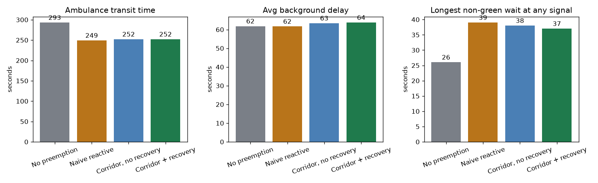
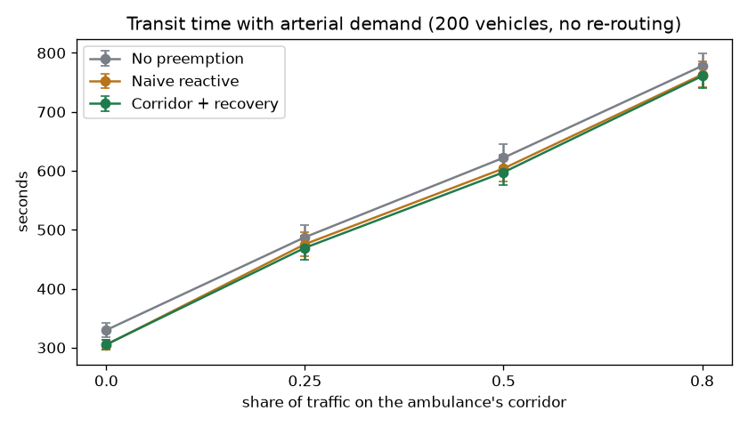
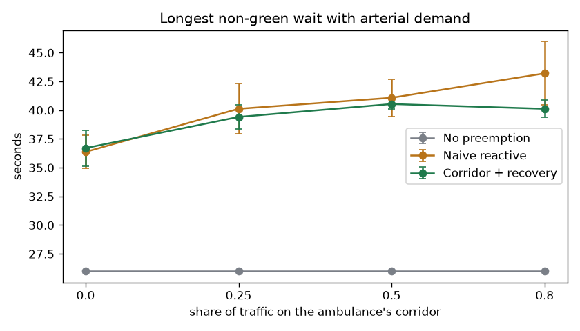

# Chapter 12 – Conclusion

## 12.1 Problem Addressed

Emergency Vehicle Preemption today is reactive: a signal learns of the ambulance when it is a few hundred metres away, flips green at once, and snaps back to its cycle when the vehicle has passed (Chapter 1). The project asked whether a system that **predicts** the ambulance's arrival at every junction ahead, **coordinates** a green corridor with a bound on the harm to cross traffic, and **eases** signals back afterwards does better than that.

## 12.2 Software Developed

A simulation system in Python: a signalised grid with stop-line queues and background traffic; a shortest-time router that re-routes; a per-junction arrival predictor; a corridor coordinator; a recovery manager; and one engine that runs four control modes (no preemption, naive reactive, corridor without recovery, corridor with recovery) on identical scenarios. Around it: multi-seed statistics with paired differences, parameter sweeps, charts, a local HTTP service, and a browser interface that replays runs, compares modes and inspects junctions (Chapters 6 and 8).

## 12.3 SDLC Model Used

Iterative and incremental development with an evaluation at the end of each iteration (Chapter 3). Four iterations were completed; three evaluations (a readiness audit, a code review and an experiment) each found defects or untrue claims that a single-pass plan would have shipped.

## 12.4 Testing Performed

**121 automated tests** (33 unit, 29 integration, 22 system, 37 specification-derived black-box cases) and a **19-check browser script**, all passing, with **98.2% statement and 96.2% branch coverage** (Chapters 9 and 10). Nineteen defects were found and fixed, among them two critical ones that mattered to the result: a cross-traffic guarantee that did not hold and signal changes that skipped yellow. Seven tests failed on their first run, which is what testing is for: four exposed real defects.

## 12.5 Major Results

All figures: 24 seeds, mean ± 95% interval, 5 × 5 grid, 80 vehicles (`docs/RESULTS.md`).

| Mode | Transit (s) | Background delay (s) | Worst wait at any signal (s) |
| --- | --- | --- | --- |
| No preemption | 300.4 ± 7.1 | 68.3 ± 1.6 | 26 |
| Naive reactive | 260.7 ± 7.4 | 68.1 ± 1.6 | 39 (not bounded) |
| Corridor, no recovery | 257.8 ± 5.3 | 68.5 ± 1.7 | 41 (bounded) |
| Corridor + recovery | 257.6 ± 5.4 | 68.7 ± 1.7 | 41 (bounded) |

1. **Preemption works.** Any preemption saves the ambulance about 14%.
2. **The predictive corridor does not beat the naive reactive baseline on transit time** over plain random-walk traffic (paired difference −3.0 ± 4.9 s) and adds about 0.6 ± 0.3 s of average background delay.
3. **What the corridor does give, and the reactive system does not, is a guarantee.** No signal ever waited longer than the fixed cycle's own stretch plus the maximum hold, in any run, at any hold value tested; the naive mode reached 39 s, and up to 56 s under heavy arterial demand.
4. **Recovery shows no measurable benefit** at any setting from zero to four cycles. The literature's figure quoted in Chapter 1.3 (recovery responsible for about 21 points of a 43% delay reduction) was **not reproduced**.
5. **Arrival prediction works:** mean error 0.5 s at arrival against 6.9 s at 60 to 90 s out.
6. **The one setting that matters** is the maximum hold: 5 s costs 20 s of transit time against 15 s; more than 15 s buys nothing.

### The experiment: is the tie caused by the model?

Plain random-walk traffic never builds the queues that an early green is supposed to clear. A share of the background vehicles was therefore made to drive the ambulance's own corridor, with re-routing off so the ambulance cannot escape the congestion.

| Arterial share (200 vehicles) | No preemption (s) | Naive (s) | Corridor (s) | Corridor − naive, transit | Corridor − naive, delay | Worst wait, naive / corridor |
| --- | --- | --- | --- | --- | --- | --- |
| 0% | 329.9 | 305.0 | 305.5 | +0.5 ± 2.3 s | +0.16 ± 0.22 s | 44 / 41 |
| 25% | 487.4 | 475.5 | 469.4 | −6.1 ± 7.8 s | −0.10 ± 0.47 s | 49 / 41 |
| 50% | 622.1 | 604.0 | 597.5 | **−6.5 ± 4.0 s** | **−0.56 ± 0.30 s** | 50 / 41 |
| 80% | 778.0 | 763.2 | 760.7 | −2.5 ± 4.3 s | −0.61 ± 0.54 s | 56 / 41 |

At 200 vehicles with half of them on the corridor, the corridor is faster than the reactive baseline by 6.5 ± 4.0 s **and** delays background traffic by 0.56 ± 0.30 s less; both intervals exclude zero. In the other cells the interval includes zero, though the sign favours the corridor in six of the eight transit comparisons across the 80- and 200-vehicle runs (the 80-vehicle table is in `docs/RESULTS.md`). With eight comparisons, one nominally significant cell is modest evidence, not proof. The unambiguous result is the wait: as arterial demand rises the naive mode's worst wait climbs from 44 s to 56 s while the corridor's stays at its cap of 41 s.

**Reading the experiment.** Part of the tie was the model: when queues form on the ambulance's own path, predictive timing starts to pay, in one setting by 6.5 s of 604 s (about 1%). But under heavy demand the ambulance itself is stuck in the queue (the model gives it no way to overtake), so preemption of any kind helps little (778 s against 763 s), and with re-routing on it simply drives around the congestion and everything ties again.

## 12.6 Assessment against the Objectives

| Objective (Chapter 1.4) | Result |
| --- | --- |
| 1. Reduce ambulance transit time | **Met**: −42.8 ± 8.8 s against no preemption |
| 2. Reduce disruption to background traffic | **Partly met**: not worse than no preemption (+0.4 s of 68 s); **not better than naive reactive** on plain traffic (+0.6 s); better in one heavy-arterial setting (−0.56 s) |
| 3. Prediction error shrinks over time | **Met**: 6.9 s to 0.5 s |
| 4. Bound the worst-case disruption | **Met**, and now enforced and tested: the worst run equals the cap and never exceeds it |
| 5. Automated, reproducible reporting | **Met**: every number and figure regenerates from a command |

## 12.7 Limitations

- **A simplified world.** Vehicles interact only through queue order and a density-based speed; there is no lane changing, no car-following, no pedestrians, no minimum green or all-red interval, and the ambulance cannot overtake a queue. Background traffic random-walks; it is not calibrated to any real city.
- **One network.** Results come from a 5 × 5 grid with identical roads and signals; they may not transfer to irregular real networks.
- **The reactive baseline is our own reading** of how existing systems behave (a 200 m trigger and an instant reset), not a measurement of a deployed product.
- **The headline claim is only weakly supported.** The corridor's advantage over a reactive system on transit time is statistically visible in one setting of eight; its clear advantage is the guaranteed bound. The recovery benefit reported in the literature was not found; it may need a more detailed traffic model, or it may not exist in this setting.
- **Testing limits.** Browser tests drove Chrome only; performance was measured on one machine; no dependency vulnerability scan was run; test code was reviewed by the same people who wrote the program.
- **Process limits.** The team's task allocation is not recorded in the repository (Chapter 7.4); the report was completed late relative to the code.

## 12.8 Future Scope

The most useful next step is to **port the simulator to SUMO** and repeat the arterial experiment with realistic car-following and an ambulance that can overtake, since that is where the corridor's advantage was largest and where this model is least realistic. After that: calibrate to a real network, add controller rules, and run the tests in continuous integration (Chapter 11.5).
