# Chapter 3 – SDLC Model Selection

## 3.1 Candidate SDLC Models

| Model | How it works | Fit for this project |
| --- | --- | --- |
| **Waterfall** | Requirements, design, implementation, testing and release run once, in order. | Poor. The requirements are stable, but the central question (does predictive coordination beat reactive preemption?) cannot be answered until a simulator exists and has been measured. A single pass would have found the model's weaknesses only at the end. |
| **Iterative** | Build a rough whole system, then refine it in repeated cycles. | Good. The simulator can be built end to end first and improved as measurement exposes its flaws. |
| **Evolutionary (prototype-based)** | Build prototypes, show them, and evolve the one users accept. | Good for the interface (three design prototypes were compared and one was kept); less relevant to the simulation core, where the requirements were known. |
| **Spiral** | Iterations driven by risk analysis, each ending in a review. | Partly. The project's main risk is that the model is too crude to show the effect being studied. Evaluating after every iteration is spiral-like, without the formal cost and risk reviews. |
| **Agile (Scrum or similar)** | Short sprints, a backlog, continuous stakeholder feedback. | Partly. The sprint rhythm and the backlog help, but there is no product owner or customer to give feedback each sprint. |

## 3.2 Selected SDLC Model with Justification

**Selected: iterative and incremental development, with an evaluation step at the end of every iteration (a lightweight, risk-driven cycle in the spirit of the Spiral model).**

Why this model:

1. **The key risk is technical, not about requirements.** The requirements were fixed early in the project brief (CLAUDE.md). What was unknown was whether a simple simulator could show the claimed benefit. That risk is retired by measuring early and often, which iteration plus evaluation does and waterfall does not.
2. **Each increment is runnable.** The build plan (`docs/BUILD-PLAN.md`) is ordered so that every step produces something that runs: grid, background traffic, baseline run, ETA, corridor, recovery, naive baseline, metrics, demo. A broken step is visible at once.
3. **Small team, one semester.** There is no room for a long up-front specification, and no customer to run sprints against. Iterations of a few days with a review at the end suit that.
4. **Evaluation drives the next iteration.** The three reviews described in 3.4 (a readiness audit, a code review, and an experiment) each produced concrete defects and requirements that the next iteration fixed.

What was deliberately not adopted: Scrum ceremonies (no standing team or product owner) and formal spiral cost estimation (no budget; see Chapter 2).

## 3.3 Mapping Project Activities to SDLC

| SDLC phase | Project activity | Artefacts |
| --- | --- | --- |
| Requirements | Project brief, literature and existing-system analysis, objectives and scope (Chapters 1, 2, 4) | `CLAUDE.md`, Chapters 1, 2 and 4, `docs/DECISIONS.md` D1 to D4 |
| Analysis and design | Architecture, use cases, UML and DFD, interface design (Chapters 5, 6) | `Appendix-A`, `Appendix-B`, Chapter 6, frontend design mocks |
| Implementation | Network, traffic, router, ETA, coordinator, recovery, engine, metrics, API, frontend (Chapter 8) | `network/`, `simulation/`, `core/`, `metrics/`, `api/`, `frontend/` |
| Testing | Unit, integration, system and acceptance testing; black-box cases; browser smoke test (Chapters 9, 10) | `tests/` (121 tests), `frontend/tests/smoke.mjs` (19 checks), generated result tables |
| Evaluation | Multi-seed sweeps, parameter sweeps, the arterial-demand experiment | `metrics/sweep.py`, `docs/RESULTS.md` |
| Deployment | Local installation and run instructions (Chapter 11) | `README.md`, `requirements.txt` |
| Maintenance | Defect correction after each review, model decisions logged (Chapter 10.5) | `docs/DECISIONS.md` M1 to M9, `docs/REPORT-STATUS.md` |

## 3.4 SDLC Execution and Evolution

The model was actually followed as a sequence of iterations, each ended by an evaluation whose findings became the next iteration's work. The commit history records it.

```mermaid
flowchart LR
    I0["Iteration 0<br/>Plan and decisions<br/>Aug 20"] --> I1["Iteration 1 (v1)<br/>End-to-end simulator<br/>3f190c8"]
    I1 --> E1{{"Evaluation 1<br/>readiness audit"}}
    E1 --> I2["Iteration 2 (v2)<br/>Model, metrics, tests, API<br/>ece8ce0"]
    I2 --> P["Prototype review<br/>3 design mocks, Cobalt chosen<br/>13fcc6b to 7131bcc"]
    P --> E2{{"Evaluation 2<br/>code review: 10 findings"}}
    E2 --> I3["Iteration 3 (v3)<br/>Bounds, safety, re-routing<br/>119ec45"]
    I3 --> E3{{"Evaluation 3<br/>arterial-demand experiment"}}
    E3 --> I4["Iteration 4<br/>Test evidence and report"]
```

| Iteration | Trigger | What was done | Evaluation result |
| --- | --- | --- | --- |
| **0. Plan** (commits `71b7994`, `8b354e9`, 20 Aug 2026) | Project start | Brief, decisions D1 to D4 (custom simulator first, synthetic grid, venv and pip), Chapters 1 and 2, design sheets, mentor brief | Scope and success criteria fixed (Chapter 1.4) |
| **1. v1** (commit `3f190c8`) | Build plan Steps 1 to 8 | Grid and signals, background traffic, router, ETA predictor, corridor coordinator, recovery, shared engine, metrics, demo. One sample run: no preemption 171 s, naive 136 s, corridor 136 s | Runs end to end, but the **readiness audit** found six defects and flaws in the metrics: the ambulance slowed itself by counting as congestion (BUG-01), the delay was measured over a different set of vehicles in each mode (BUG-02), `recovery_cycles=0` crashed (BUG-03), and there was one seed, no tests, no confidence intervals. The claimed result was not trustworthy |
| **2. v2** (commit `ece8ce0`) | Audit findings | Fixed the metric and model flaws (M1 to M5), added stop-line queues so that a late green has a cost, a corridor-without-recovery mode, multi-seed confidence intervals and sweeps, ETA-accuracy logging, 48 tests, a replay API | After the fixes, corridor and naive reactive were statistically tied; the "bounded" claim did not hold |
| **Prototype review** (commits `13fcc6b` to `7131bcc`) | Need for an interface | Three design prototypes (Cobalt, Blueprint, Coral) were built on one shared renderer; the project owner picked Cobalt; it was polished and finalised | Interface accepted; two prototypes retired (kept in git history) |
| **3. v3** (commit `119ec45`) | **Code review**: 10 findings | A real cross-traffic bound, signal-safety rules on every shift, re-routing, API hardening, NaN handling, a shared CLI helper; 69 tests | The bound now holds in every run; corridor still ties naive on transit |
| **4. Experiment and evidence** (this iteration) | Is the tie caused by the model? | Added arterial demand (queues on the ambulance's own corridor), black-box cases, coverage, benchmark, browser smoke test, this report | Small corridor advantage in one heavy-demand setting; elsewhere a tie (Chapter 12) |

**What the model bought.** Each evaluation found problems that a single-pass plan would have shipped: the first demo's numbers were an artefact of two bugs; the "bounded hold" guarantee was false until iteration 3; and the question of whether the model was too crude was answered by an experiment in iteration 4. **What went less well.** The report lagged the code, so the report structure was only aligned in iteration 4, and the first iteration was tested with one seed and no automated tests.

*Note on process:* the readiness audit and code review were carried out with an AI-assisted review tool; their findings were checked against the code, and the fixes were verified with tests before being accepted.
