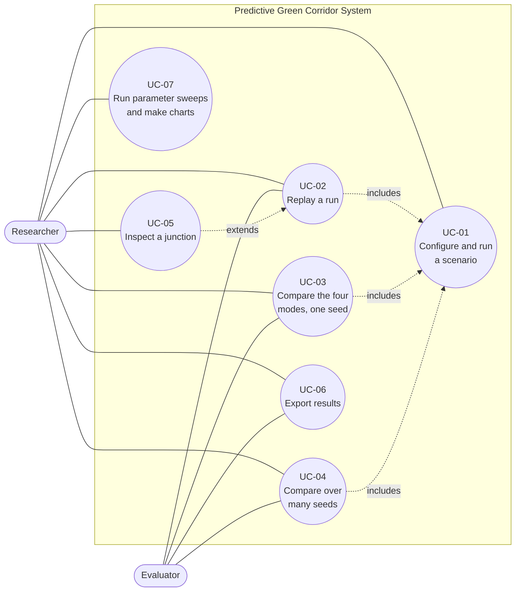

# Chapter 5 – System Analysis

## 5.1 Existing System

Emergency Vehicle Preemption (EVP) as deployed today (Chapter 1.1) works at one junction at a time. A detector (optical, radio or GPS emitter, or acoustic) notices the vehicle roughly 150 to 300 m from the junction. The controller then cuts its current phase and forces a green in the vehicle's direction, and when the vehicle has passed it returns to its normal cycle at once.

In this project that behaviour is modelled as the **naive reactive** mode: the signal reacts only when the ambulance is within 200 m, forces green with no bound on the cost to cross traffic, and resets instantly. The **no preemption** mode is the control: the signals simply run their fixed cycle.

## 5.2 Limitations of the Existing System

1. **Short horizon, one junction at a time.** About 14 seconds of warning at urban speeds is not enough to clear a queue standing at a red light, and nothing coordinates the junctions along the route.
2. **Unbounded cost to cross traffic.** Nothing limits how long the perpendicular direction waits. In the simulation, the naive mode's worst wait at a signal reached 39 s at a 200 m trigger and 49 s at 400 m, against 26 s for the fixed cycle.
3. **Abrupt recovery.** Traffic held during preemption is released all at once.
4. **No measurement of its own prediction.** A reactive system has no arrival estimate to check.

## 5.3 Proposed System and its Advantages

The **Predictive Green Corridor System** predicts the ambulance's arrival at every junction ahead, schedules a green timed to each arrival within a look-ahead horizon, refuses any change that would wait cross traffic longer than a fixed bound or skip a yellow, and eases each signal back to its cycle after the ambulance passes. It is built and evaluated as a simulation (Chapter 1.5).

Measured advantages (Chapter 12, `docs/RESULTS.md`):

| Advantage | Evidence |
| --- | --- |
| Saves the ambulance about 14% of its transit time against no preemption | 300 s down to 258 s, 24 seeds |
| **Guaranteed** bound on cross-traffic waiting: never more than the cycle's own stretch plus the maximum hold | Worst single run equals the cap exactly (31, 36, 41, 46 s for holds of 5, 10, 15, 20 s); naive reaches 39 to 56 s |
| Never skips a yellow | `test_signals_never_skip_a_yellow` in all four modes |
| Prediction error shrinks as the ambulance approaches | 0.5 s at arrival, 6.9 s at 60 to 90 s out |
| Reproducible, automated reporting | Sweeps, charts, CSV export |

Measured **non**-advantages, stated plainly: the predictive corridor is not distinguishable from the naive reactive baseline on ambulance transit time over a plain random-walk traffic model (paired difference −3.0 ± 4.9 s), it adds about 0.6 s of average background delay, and recovery shows no measurable benefit. Under heavy arterial demand it is faster in one setting (Chapter 12.2).

## 5.4 Use-Case Model

**Actors**

| Actor | Role |
| --- | --- |
| **Researcher** (primary) | Sets up scenarios, runs and replays them, compares modes, exports results |
| **Evaluator** (secondary) | Reads the results and the report; may re-run a scenario to check it |
| **Simulation engine** (system) | Runs the four control modes tick by tick |
| **Browser** (external) | Renders the interface and talks to the local service |

## 5.5 Use-Case Descriptions

### UC-01 Configure and run a scenario

| | |
| --- | --- |
| **Actor** | Researcher |
| **Preconditions** | The service is running (`python -m api.server`) and the page is open |
| **Main flow** | 1. The user picks a traffic preset or edits the fields (seed, vehicles, max hold, look-ahead, recovery cycles, signal shift, reactive trigger). 2. The user presses *Run scenario*. 3. The system validates the values, runs the four modes, and returns the replay. 4. The page shows the verdict, the map, the signal timeline and the mode table. 5. The address bar records the scenario. |
| **Alternative flows** | **A1** A value is not a number or is not finite: the service answers 400 and the page shows the reason (TC-04, TC-06, TC-07, ST-16). **A2** A number is out of range: it is clamped to the nearest limit (TC-02, TC-03). **A3** The user edits fields but does not run: the page says the replay still shows the last run (ST-08). **A4** The service is not running: the page shows the bundled sample and says scenarios cannot be changed. |
| **Postcondition** | A replay of four modes is displayed and its scenario is in the URL |
| **Tests** | TC-01 to TC-18, TC-33, TC-35, ST-01, ST-08, ST-11, ST-16 |

### UC-02 Replay a run

| | |
| --- | --- |
| **Actor** | Researcher, Evaluator |
| **Preconditions** | A replay is loaded (UC-01) |
| **Main flow** | 1. The user presses *Play*, or drags the time slider, or clicks the signal timeline. 2. The map shows signals changing, vehicles moving and stopping, ringed junctions where the controller has shifted the phase, and a countdown to the predicted arrival on junctions ahead. 3. The user picks another mode and the same moment is shown under that mode. |
| **Alternative flows** | **A1** Playback reaches the end and stops. **A2** The user changes speed (1×, 4×, 16×). |
| **Postcondition** | The display is at the chosen moment and mode, recorded in the URL |
| **Tests** | ST-04, ST-05, `test_frames_are_recorded_for_the_frontend` |

### UC-03 Compare the four modes on one seed

| | |
| --- | --- |
| **Actor** | Researcher, Evaluator |
| **Preconditions** | A replay is loaded |
| **Main flow** | 1. The user reads the mode buttons (transit time per mode) and the mode table (transit, difference against no preemption, background delay, longest wait). 2. Differences are coloured by whether they help. |
| **Alternative flows** | **A1** A mode's ambulance did not arrive within the tick limit: the figure shows *n/a* and the readout says so (`test_tick_limit_reports_no_transit_time_instead_of_crashing`). |
| **Postcondition** | None; this is a read-only view |
| **Tests** | TC-32, ST-03 |

### UC-04 Compare over many seeds

| | |
| --- | --- |
| **Actor** | Researcher, Evaluator |
| **Preconditions** | A live replay is loaded (the service is needed) |
| **Main flow** | 1. The user presses *Compare over 12 seeds*. 2. The service runs 48 simulations on a shared process pool. 3. The page shows means with 95% confidence intervals, differences paired by seed, and one bar per seed for transit and for background delay. 4. The readout adds whether background delay is distinguishable from no preemption. |
| **Alternative flows** | **A1** Some runs did not finish: they are left out and the page says how many. **A2** The user edited fields since the last run: the comparison still uses the scenario on screen (ST-09). **A3** The user is on *No preemption*: the page explains how to see the bars (ST-10a). |
| **Postcondition** | The comparison is shown; nothing is stored |
| **Tests** | TC-34, `test_compare_modes_*`, ST-09, ST-10, ST-10a |

### UC-05 Inspect a junction

| | |
| --- | --- |
| **Actor** | Researcher |
| **Preconditions** | A replay is loaded |
| **Main flow** | 1. The user clicks a junction, or focuses it and presses Enter. 2. A panel shows its position on the route, the signal state for each direction, the current and largest phase shift, the predicted arrival now, when the ambulance arrived, how far off the prediction was 30 s and 10 s ahead, and how long the signal had been green on arrival. 3. The user closes it with *Close* or Escape and focus returns to the junction. |
| **Alternative flows** | **A1** The junction is not on the ambulance's route: only the signal facts are shown. |
| **Postcondition** | The panel is closed and the junction has focus |
| **Tests** | ST-06, ST-07 |

### UC-06 Export results

| | |
| --- | --- |
| **Actor** | Researcher, Evaluator |
| **Preconditions** | A replay is loaded; the 12-seed table is added to the file if it has been run |
| **Main flow** | 1. The user presses *Export CSV*. 2. The browser downloads a CSV with the scenario in a comment line, the four-mode table and, if available, the across-seeds table. |
| **Alternative flows** | None |
| **Postcondition** | A file is saved by the browser |
| **Tests** | ST-12 |

### UC-07 Run parameter sweeps and make charts

| | |
| --- | --- |
| **Actor** | Researcher |
| **Preconditions** | The virtual environment is installed |
| **Main flow** | 1. The user runs `python -m metrics.sweep --seeds 24`. 2. The system runs the standard suite (modes, load, max hold, horizon, recovery cycles, signal shift, arterial demand, reactive trigger) in parallel and writes `outputs/sweep_results.json`. 3. The user runs `python -m scripts.make_report_figures` to draw the charts. |
| **Alternative flows** | **A1** `--out` names a directory that does not exist: it is created. **A2** A run does not finish: it is excluded from the averages and counted. |
| **Postcondition** | JSON and PNG files exist |
| **Tests** | `test_standard_suite_runs_every_section_and_serialises`, `test_export_accepts_a_bare_filename`, `test_every_chart_is_written` |
