# Chapter 6 – System Design

The notation set drawn before implementation is kept in [Appendix A](Appendix-A-Design-Sheets.md) (design sheets) and [Appendix B](Appendix-B-UML-and-DFD.md) (DFD, use case, activity, sequence and class diagrams in PlantUML). This chapter describes the design **as built**; where the build differs from the early drawings, the difference is noted.

## 6.1 System Architecture

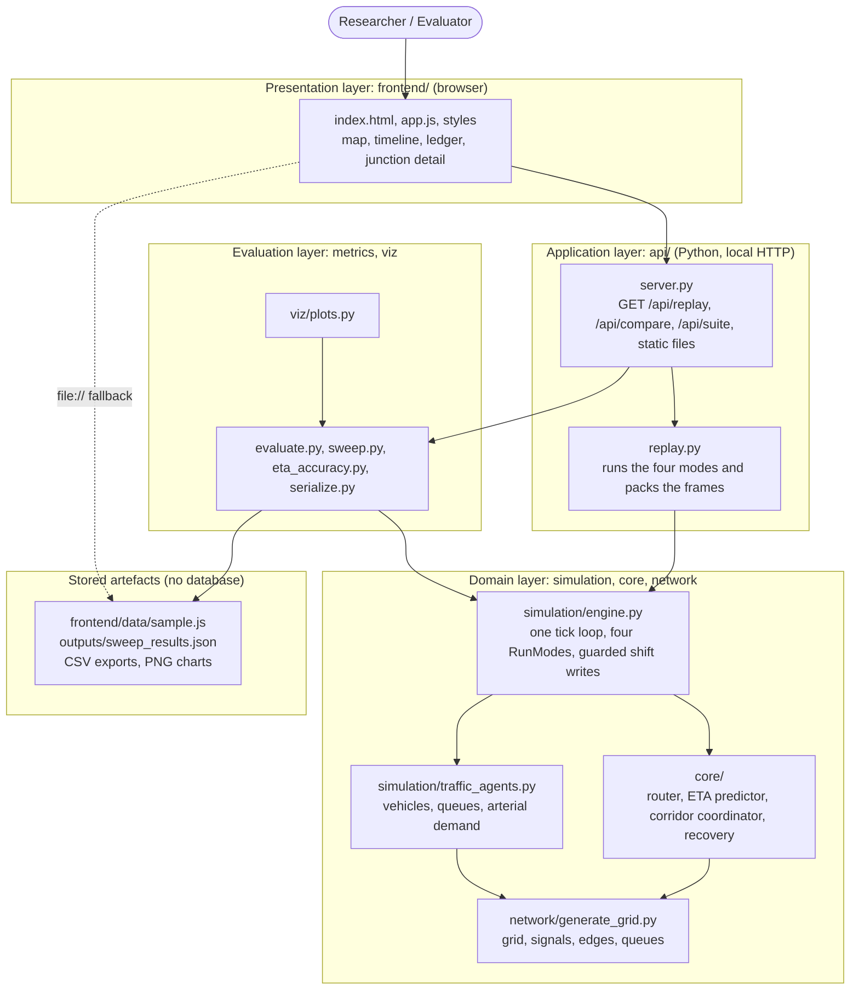

Reading it top to bottom: the user works in the browser; the page calls the local service; the service builds scenarios and asks the engine to run them; the engine uses the domain modules; metrics are computed from the run logs; results can be written to files.

## 6.2 Architectural Design

Four architectural ideas are combined, each chosen for a reason:

| Style | Where | Why |
| --- | --- | --- |
| **Layered** | The four layers in 6.1; each depends only on the one below | A change to the interface cannot break the simulation, and the simulation can be run from the command line with no web code at all |
| **Client–server (local)** | Browser and Python service over HTTP and JSON | The simulation needs Python and `networkx`; the interface needs a browser. A thin JSON interface keeps them independent (decision F1) |
| **Pipeline of small modules** | Router → ETA predictor → coordinator → recovery, all driven by one engine | The brief names these as separate algorithms to build in order; each has its own tests, and a SUMO port could replace the engine without rewriting them (decision D1) |
| **Single write path with guards** | Every phase shift goes through `SimulationEngine._set_shift` | Signal safety and the cross-traffic bound are enforced in **one** place, so no mode can bypass them by accident (decisions M6, M7) |

A design choice that matters for fairness: all four modes run through the **same** tick loop and differ only in how a signal's `phase_offset_shift` gets set. The comparison between modes therefore compares control strategies, not simulators.

## 6.3 UML Diagrams

The full PlantUML set is in Appendix B. The diagrams below are the as-built versions most relevant to the design.

### Class diagram

See Appendix B, diagram D9, rewritten to match the code (vehicles, network, signals, engine, coordinator, recovery, scenario, metrics, API).

### Component diagram

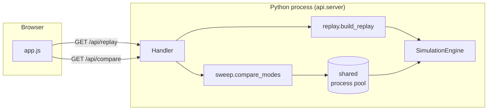

### Sequence diagram: one simulation tick

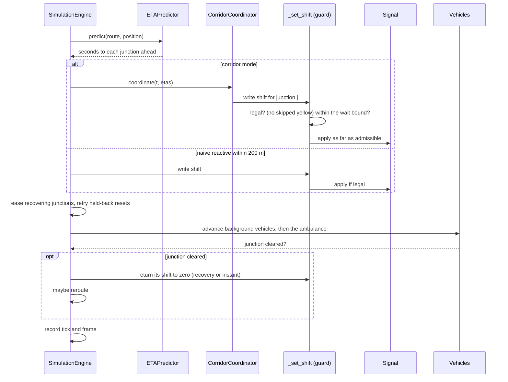

### Activity diagram: one run

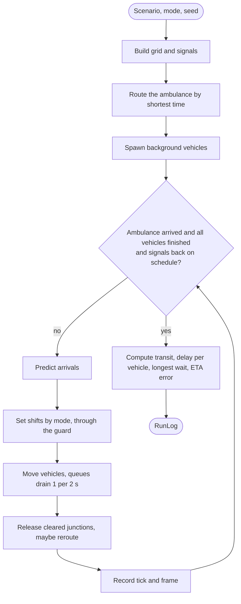

### State diagrams

**Signal phases** (one direction; the other is the mirror image half a cycle later). The legal changes caused by a shift are the same arrows; the three arrows that are *not* drawn (green to red, red to yellow, yellow to green) are refused by the guard.

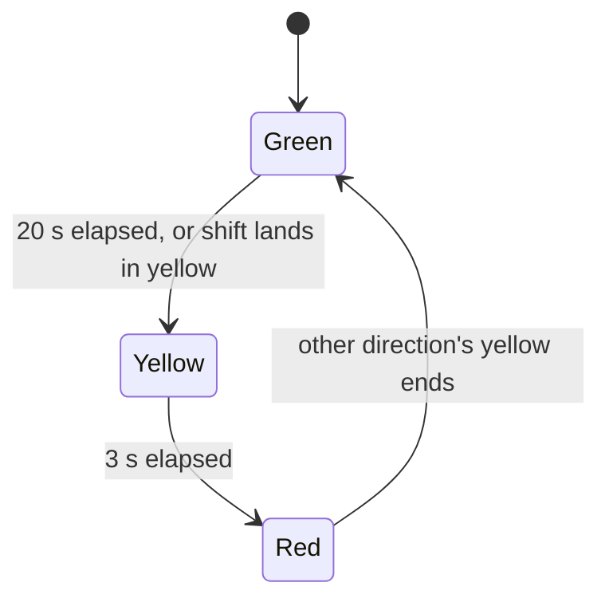

**Junction preemption and recovery** (per junction on the route):

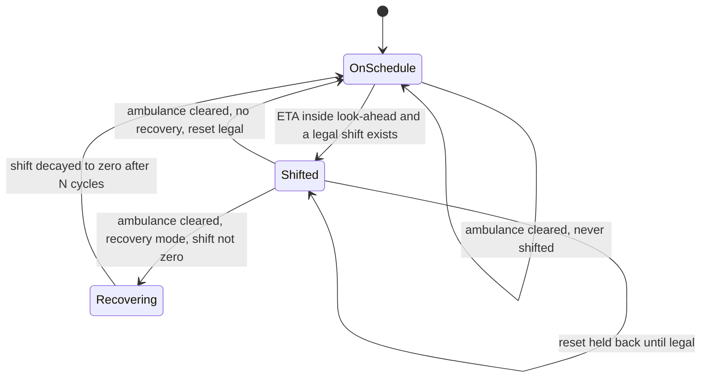

**Ambulance:**

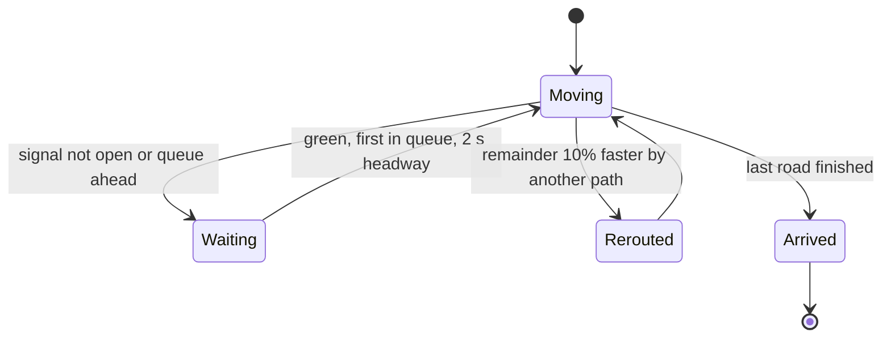

### Deployment diagram

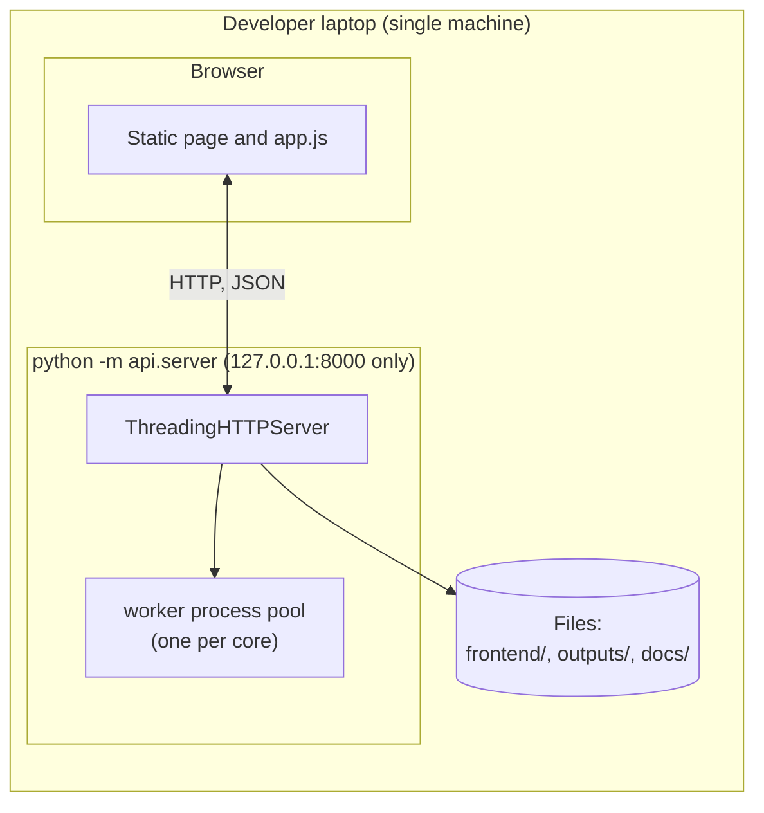

## 6.4 Database Design

**The system has no database, by decision.** Decision D3 chose the simplest toolchain (a virtual environment and pip). The data is regenerated from a scenario and a seed in milliseconds, and nothing needs to persist between runs, so a database would add install and migration cost and no benefit. No user accounts exist (Chapter 1.5), so there is nothing to store about people.

What does persist is files, and the logical data model is below. It is drawn as an ER diagram because that is how the data relates, even though it lives in memory and JSON, not tables.

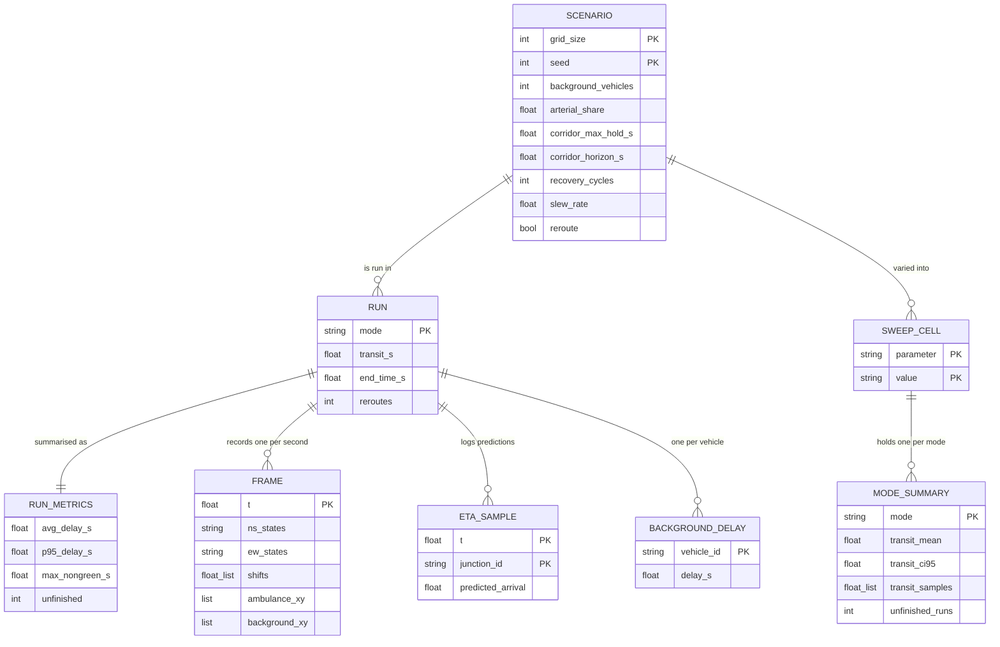

**Keys.** Primary keys above are the natural keys of each record. Foreign keys are implicit in nesting: a run's frames sit inside the run's JSON object, and a sweep cell's summaries sit inside the cell. **Persisted files**:

| File | Content | Written by |
| --- | --- | --- |
| `frontend/data/sample.js` | One four-mode replay and one 12-seed comparison, as two JavaScript assignments | `python -m api.export` (not committed; regenerated) |
| `outputs/sweep_results.json` | The full sweep suite, strict JSON (non-finite numbers are `null`) | `python -m metrics.sweep` |
| `*.csv` | The mode table and the across-seeds table | *Export CSV* in the interface |
| `outputs/*.png`, `docs/report/figures/*.png` | Charts | `demo.py`, `scripts/make_report_figures.py` |

## 6.5 Data Flow Diagrams

**Level 0 (context).**

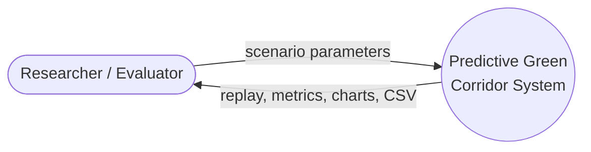

**Level 1.**

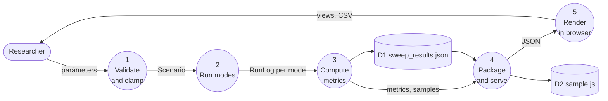

**Level 2 for process 2 (Run modes).** The tick loop of 6.3: predict, set shifts through the guard, move vehicles, release and reroute, record. The formal Level 1 and Level 2 diagrams drawn before the build are in Appendix B (D5).

## 6.6 Interface Design

The interface is a single working screen, a tool people operate rather than a page they read, so the design follows the conventions of dashboards: a top bar, a scenario panel on the left that stays in view, the replay in the centre, and results on the right. Three complete prototypes were built on the same renderer and compared (Cobalt, Blueprint, Coral); the project owner chose **Cobalt**.

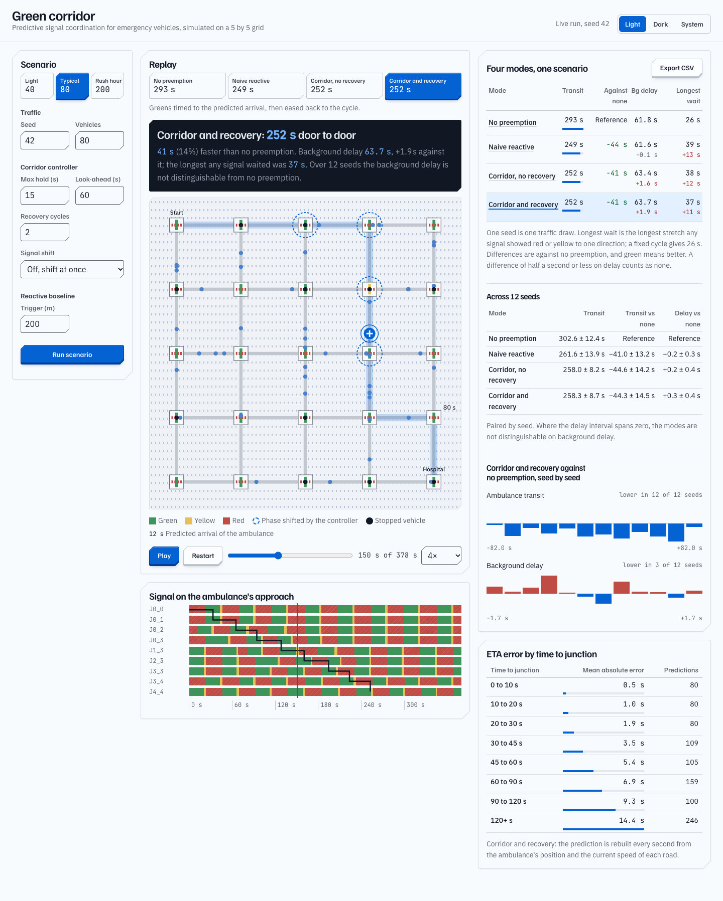

*Figure 6.1: Desktop, light appearance.*

| Region | Purpose | Design decision |
| --- | --- | --- |
| **Scenario rail** (left, fixed on scroll) | Presets and fields, grouped as Traffic, Corridor controller, Reactive baseline | Presets (Light, Typical, Rush hour) switch the load in one click; edits that have not been run are flagged |
| **Mode buttons** | Choose the control mode, each showing its transit time | The answer is on the control, not only in a table |
| **Verdict readout** (dark panel) | One sentence on what the run showed, with the multi-seed verdict once compared | The finding comes first, in the largest type on the page |
| **Signal grid** | The replay | Signals drawn large; dashed rings where the controller shifted the phase; a live countdown to the predicted arrival on junctions ahead; red uses a dashed line as well as colour |
| **Signal timeline** | State of each route junction's approach over time | Green, yellow and red with a hatched red; the ambulance's path drawn through it; click to seek |
| **Mode table, across-seeds table, per-seed bars** | Numbers and their spread | Differences are coloured by whether they helped; the bars show the seed-to-seed spread behind each average |
| **Junction detail** | Why one junction behaved as it did | Opens on click or Enter; Escape closes it and returns focus |

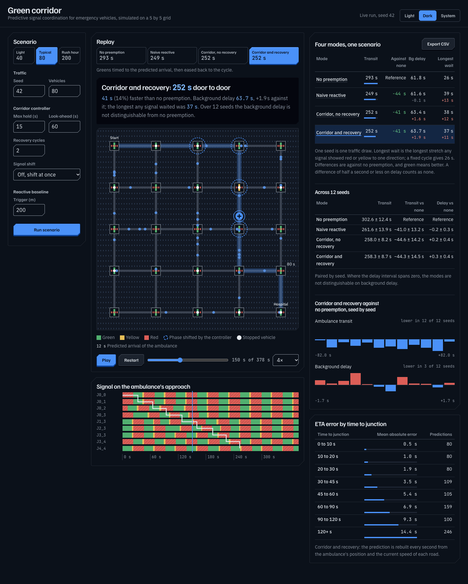

*Figure 6.2: Dark appearance (Light, Dark and System are offered; the choice is remembered in the browser).*

**States.** Every region that loads data has four states: *loading* (a skeleton grid), *error* (the server's reason, and *Try again*), *sample* (bundled data when opened from disk, with the limits explained) and *full*.

**Accessibility.** The page is keyboard operable; every interactive element has a visible focus ring; the mode switch is a radio group with arrow-key navigation, and the presets and appearance switch are labelled buttons; colours are never the only cue (signals also differ in line style, and the run state is stated in text); reduced-motion preferences switch off the count-up animation; the layout has no horizontal scrolling down to 390 px (ST-17).

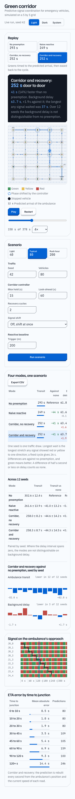

*Figure 6.3: Phone width (390 px). Tables scroll inside their panels.*

**Reference review.** Components from the ObsidianUI analytics dashboard and component library were reviewed (decision F2). Adopted: deltas coloured by whether they helped, rolling figures, scenario presets, a details panel that closes with Escape, status-bar strips (as the per-seed bars), export, and a light and dark setting. Not adopted: sparkline cards, sidebar pages, an assistant composer, and decorative motion.

## 6.7 Where the Build Differs from the Early Design

| Early design (Appendices A and B) | As built | Why |
| --- | --- | --- |
| Three run modes | Four (corridor without recovery added) | The recovery ablation the brief asks for needs it |
| `Signal.apply_schedule` and a `SignalSchedule` object | A single `phase_offset_shift` per signal, written through one guarded function | One mechanism lets recovery ease out of exactly what preemption put in, and puts the safety rules in one place |
| Route computed once | Recomputed on entering each road | CLAUDE.md 6.1 asks for it; the audit found it missing |
| Stop at the ambulance's arrival | Run until every vehicle finishes and signals are back on schedule | Delay must be measured over the same vehicles in every mode |
| No queue model | Stop-line queues, 2 s discharge | Without queues a late green costs nothing |
