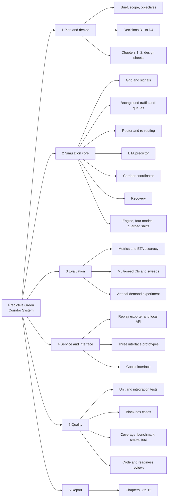
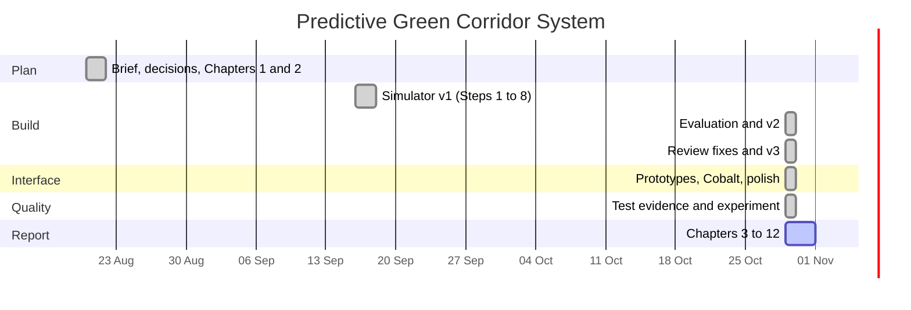

# Chapter 7 – Project Planning and Management

## 7.1 Work Breakdown Structure

## 7.2 Project Schedule

The dates come from the repository's commit history and file timestamps; they record what happened, not an after-the-fact plan.

| Phase | Work | Dates (2026) | Evidence |
| --- | --- | --- | --- |
| 0 Plan and decide | Brief, decisions D1 to D4, Chapters 1 and 2, design sheets, mentor brief | 20 Aug | commits `71b7994`, `8b354e9` |
| 1 Simulator v1 | Build plan Steps 1 to 8 | mid Sep (files of 16 to 17 Sep), committed 29 Oct | commit `3f190c8` |
| 2 Evaluation and v2 | Readiness audit, model fixes M1 to M5, tests, sweeps, API | 29 Oct | commit `ece8ce0` |
| 3 Interface | Three prototypes, selection, polish, finalisation | 29 Oct | commits `13fcc6b`, `ed8ea9e`, `7131bcc` |
| 4 Review and v3 | Code review, fixes M6 to M9 | 29 Oct | commit `119ec45` |
| 5 Experiment and test evidence | Arterial demand, black-box, coverage, benchmark, smoke test | 29 Oct | this chapter's commit |
| 6 Report | Chapters 3 to 12, figures, generated tables | 29 Oct onward | `docs/report/` |

One honest note on the schedule: the code was written in September but most of it was committed in a single burst at the end of October, so the commit history compresses the real timeline. The report was started first (August) and then fell behind the code, which is why Chapters 3, 4, 5 and 7 to 12 were written together in the last phase.

## 7.3 Gantt Chart

## 7.4 Task Allocation

The team's allocation is **not recorded in the repository** and has not been invented here. The table below lists the work packages with a column per team member for the team to complete before submission.

| Task | Student 1 | Student 2 | Student 3 | Student 4 |
| --- | --- | --- | --- | --- |
| Requirements and analysis (Chapters 1 to 5) | | | | |
| Design (Chapter 6, appendices) | | | | |
| Simulation core (network, traffic, router, ETA) | | | | |
| Coordinator, recovery, engine | | | | |
| Metrics, sweeps, experiment | | | | |
| Service and interface | | | | |
| Testing and defect log (Chapters 9, 10) | | | | |
| Report assembly and review | | | | |

## 7.5 Risk Register

| Risk | Probability | Impact | Mitigation | What actually happened |
| --- | --- | --- | --- | --- |
| The simulator is too crude to show the effect studied | High | High | Measure early; run an experiment that tests the model, not only the algorithm | Materialised: corridor ties naive on plain traffic. The arterial experiment (Chapter 12) shows a small advantage in one heavy setting only |
| A single result is mistaken for a finding | High | High | Multi-seed runs, 95% confidence intervals, paired differences | The v1 demo (one seed) hid two bugs; fixed in v2 |
| A claimed guarantee does not hold | Medium | High | Test the guarantee directly | The "bounded hold" held for the shift but not for waiting (59 s against a 41 s promise); fixed with a guard and a test (BUG-07) |
| Unsafe signal behaviour in the model | Medium | High | Rules and a test over every frame | Shifts skipped yellows; fixed (BUG-08) |
| Requirement change | Medium | Medium | Iterative plan with a review at the end of each iteration | Requirements FR-03, FR-06, FR-07 and FR-15 were added after reviews |
| SUMO installation or port risk | Medium | Medium | Decision D1: custom simulator first, SUMO later | SUMO never needed for the MVP; port deferred |
| Report falls behind the code | High | Medium | Track against the report structure | Materialised; corrected in this phase |
| Invalid input crashes the service | Medium | Medium | Validate and clamp; return 400 | NaN and infinity crashed the handler until BUG-10 |
| Loss of work | Low | High | Git, small commits | All work committed; no remote yet (decision D4) |
| Interface does not suit the users | Medium | Low | Build several prototypes and choose | Three prototypes built; Cobalt chosen |
